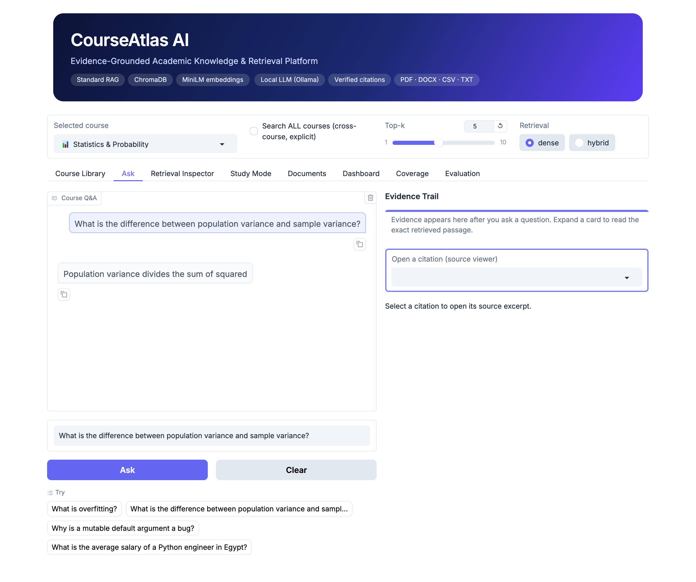
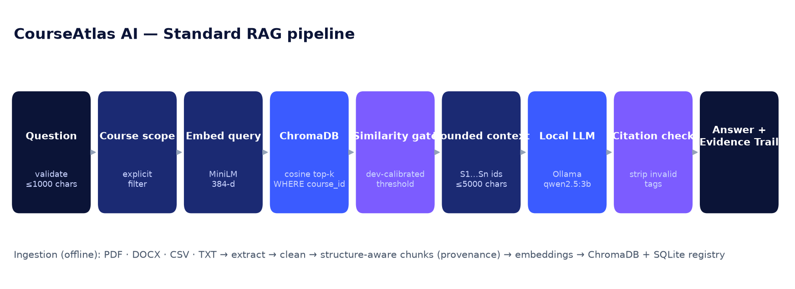
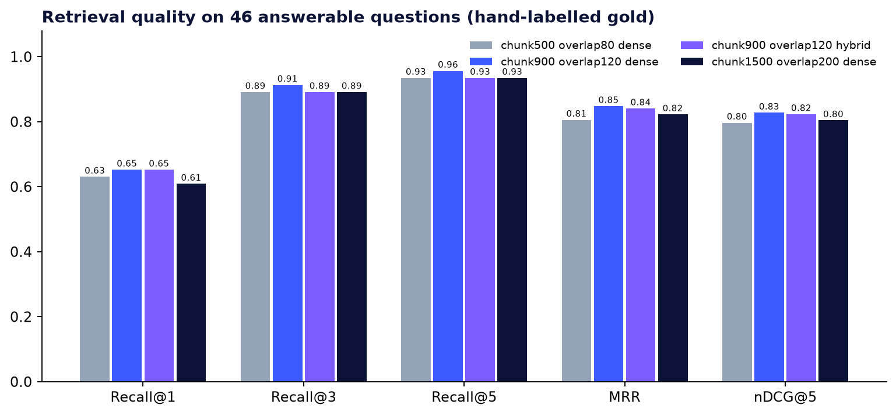
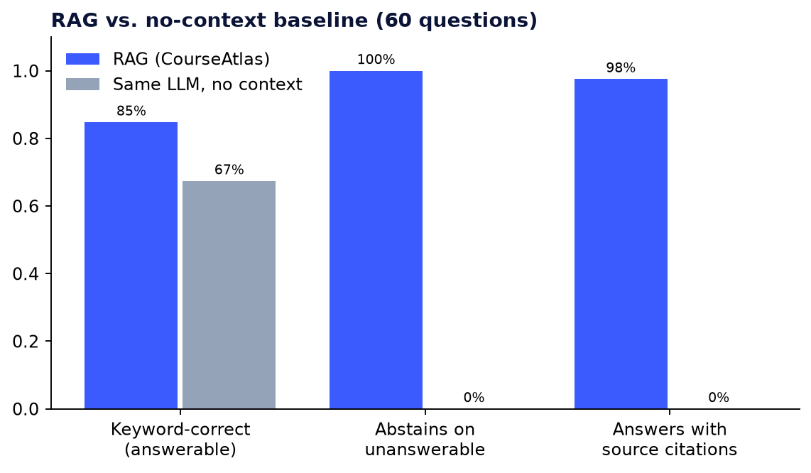

# CourseAtlas AI
**Evidence-Grounded Academic Knowledge & Retrieval Platform** — a multi-course **Standard RAG** system.

Sprint 4 (GANs & AI Agents) · Project 2 — *Standard Course Q&A RAG System* · INSTANT AI & Data Science Training · by Faris Mohamed Kishtah



## Assignment mapping
| Requirement (slide 28) | Where |
|---|---|
| 3 courses, PDF/CSV/DOCX/TXT | `data/sample_courses/{python,statistics,ml}` (4 formats each) |
| Extract, clean, chunk | `src/ingestion/` |
| Embeddings + vector DB | MiniLM-L6-v2 → ChromaDB (`src/embeddings`, `src/vectorstore`) |
| Retriever + LLM | `src/retrieval`, `src/generation` (Ollama, local) |
| Answers from retrieved content with source attribution | `src/citations`, Evidence Trail UI |
| Streamlit or Gradio | `app.py` (Gradio) |

Deliberately **Standard RAG** — no query rewriting, corrective loops or agents (those are separate Sprint-4 projects).

## Architecture


Question → explicit course scope → query embedding → ChromaDB cosine search **filtered by `course_id`** → similarity gate → bounded context (ids `S1…Sn`) → local LLM → citation validator → answer + Evidence Trail. Details and decisions: [docs/ARCHITECTURE.md](docs/ARCHITECTURE.md).

- **Course isolation** is a metadata filter in the vector query (not a prompt instruction). Cross-course search must be ticked explicitly.
- **Citations** are generated from retrieval metadata (`[Doc — Page 4 (3. Functions)]`, `Row 14`, `Lines 34-37`, `Section: …`); any tag the model invents is stripped; the source viewer re-reads the chunk from the index. A citation proves *where the text came from*, not that the answer is fully correct.
- **Abstention**: dev-calibrated similarity gate + the model's refusal. 
- **CSV**: rows are atomic chunks keeping column names. Narrow aggregates (mean/sum/min/max/count of one numeric column, when the question names the CSV/column) are computed with pandas, never by the LLM.
- **Lifecycle**: SHA-256 idempotent indexing, replace-on-change without stale chunks, duplicate detection, delete, reindex, rebuild; a failed update never corrupts the previous index.
- **UI modules**: Course Library · Ask (Evidence Trail + source viewer) · Retrieval Inspector · Study Mode (summarize/explain/compare/quiz, grounded) · Documents (validated upload) · Dashboard · Coverage · Evaluation.

## Data
12 files, 3 courses, 21 PDF pages, 6,954 words, 128 chunks. **All content is original, written for this project (CC BY 4.0) — not official university material.** Full per-file audit: [docs/DATA_SOURCE_AUDIT.md](docs/DATA_SOURCE_AUDIT.md). The text files contain deliberate prompt-injection lines for security testing.

## Results (real measurements — [docs/EVALUATION.md](docs/EVALUATION.md))
Retrieval on 46 hand-labelled answerable questions: **Recall@1 0.652 · Recall@3 0.913 · Recall@5 0.957 · MRR 0.848** (900/120 chunks, dense). Hybrid BM25 gave no gain, so it is not the default. Course filter: 0 cross-course hits / 300.

End-to-end with `qwen2.5:3b-instruct` on 60 questions: keyword-correct **84.8%** on answerable (no-context baseline 67.4%); refuses **14/14** unsupported/out-of-course/vague questions (baseline 0%); 97.6% of answers carry a valid citation; **10.9% false abstentions** (5/46) caused mostly by the similarity gate. Mean latency ≈ 4.2 s on an 8 GB M2.

Honest weaknesses: small-model answers to *vague* questions can be misleading (`st-040`), cross-document questions can miss the second source at small k, and keyword-correctness is a proxy (13 answers manually reviewed, no claim of zero hallucination).

 

More screenshots: `artifacts/screenshots/` (library, citation viewer, abstention, inspector, documents, dashboard, evaluation, mobile).

## Run it
Requires Python ≥3.10 and [Ollama](https://ollama.com).
```bash
python3 -m venv .venv && source .venv/bin/activate
pip install -r requirements.txt
ollama pull qwen2.5:3b-instruct         # ~1.9 GB; see docs/LICENSES.md for the licence
python scripts/prepare_courses.py       # regenerates the demo PDF/DOCX/CSV/TXT files
python scripts/build_index.py           # incremental, idempotent
python app.py                           # http://127.0.0.1:7860
```
Reproduce evaluation: `python scripts/build_eval_set.py && python scripts/evaluate.py retrieval && python scripts/evaluate.py generation && python scripts/benchmark.py && python scripts/make_report.py`.
Tests: `pytest` (52 tests incl. real-model acceptance tests A–J; the integration tests are *skipped*, not passed, if Ollama is not running).
Config: `configs/*.yaml`; `COURSEATLAS_READ_ONLY=1` disables uploads/deletes.

## Security & licences
[docs/SECURITY.md](docs/SECURITY.md) · [docs/LICENSES.md](docs/LICENSES.md). Note: Qwen2.5-3B is non-commercial; PyMuPDF is AGPL.

## Deployment status
Local app: complete. **No public live demo**: a free hosted Space cannot run the local LLM, and a static page would not be real RAG. See PROJECT_STATUS.md.

## Future work
Reranking, multi-query for cross-document questions, OCR as an opt-in, per-user sessions for safe public uploads, human grading of a larger answer sample.

## Acknowledgement
Built as part of the **INSTANT AI & Data Science Training** programme (Sprint 4). Models are used as published; nothing here was trained by the author.
